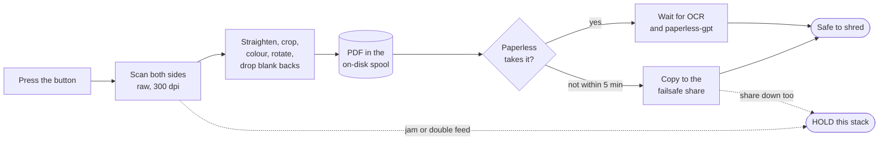

<p align="center">
  
</p>

<h1 align="center">scanstation</h1>

<p align="center">
  Put the paper in, press the button, shred the stack.<br>
  A Raspberry Pi that turns a Fujitsu ScanSnap S1500 into a one-button scanner for <a href="https://docs.paperless-ngx.com/">Paperless-ngx</a>.
</p>

<p align="center">
  <a href="https://github.com/albatrossflavour/scanstation/actions/workflows/test.yml"></a>
  <a href="LICENSE"></a>
</p>

---

The ScanSnap S1500 is a fast duplex document scanner that Fujitsu stopped writing software for. scanstation runs on a Pi next to the scanner, with no screen or keyboard. Every press of the scanner's blue button is one document. Both sides are scanned, straightened, cropped, and cleaned up, blank backs are dropped, and the PDF goes to Paperless. Then a message on your phone tells you whether it's safe to shred the paper.

scanstation only says "Safe to shred" once Paperless has the document, or a copy is sitting on your failsafe share. If anything went wrong, the message starts with "HOLD this stack" and says why.

## What happens when you press the button



The spool is on disk and every state change is a file, so a power cut or restart never loses a scan. A slow Paperless doesn't hold up the next stack, because uploads run between button presses.

## The messages

Messages go to [Pushover](https://pushover.net/). Without Pushover keys they go to the journal instead.

| You see | It means |
|---|---|
| Safe to shred: Council Rates Notice (2 pages) | Paperless has it and nothing about the scan needs a look |
| Safe to shred: Paperless is unreachable, so scanstation-20261116-091502.pdf (3 pages) is on the NAS | Paperless was down. The copy on your share goes in when it's back |
| HOLD this stack: jam or double feed, rescan the whole document | Nothing was kept. Feed it again. If it was a card or thick envelope, the next press skips the double-feed check |
| HOLD this stack: Council Rates Notice (2 pages) is in Paperless but needs a look: content touches an edge | It's stored, but check the scan before you shred |
| HOLD this stack: Paperless and the NAS are both unreachable, so ... is only on the Pi | Keep the paper until one of them is back |

## What it does

- One press is one document, both sides of every sheet, up to a full 50-sheet hopper
- Straightens every sheet, and crops to the paper without cutting into small cards like licences or bank cards
- Colour correction fitted against Fujitsu's own ScanSnap Manager output, with each page saved as colour or greyscale depending on what's on it
- Drops blank backs, including ones with fold creases, but keeps sparse forms
- Turns upside-down and sideways pages the right way up using tesseract
- Double-feed detection, and after a jam the next press within two minutes skips the thickness check so a card or thick envelope can go through
- Waits for [paperless-gpt](https://github.com/icereed/paperless-gpt) to title the document, if you run it
- Flags pages that are still crooked, have content touching an edge, or came out with almost no text
- Wakes the scanner when it falls asleep after 15 minutes idle, so you can leave the chute open
- Optional archive of every scan on your share, filed by year

## What you need

- A Fujitsu ScanSnap S1500 or S1500M
- A Raspberry Pi running Raspberry Pi OS (Debian 13). It's built and run on a Pi 5. Older Pis are untested, and page processing will probably be slower
- A Paperless-ngx server the Pi can reach
- Optional: a Pushover account, an NFS share for the failsafe, and paperless-gpt

## Quick start

On the Pi:

```bash
git clone https://github.com/albatrossflavour/scanstation.git
cd scanstation
sudo ./setup.sh
```

Setup asks for your Paperless URL, offers to create a locked-down `scanstation` user in Paperless for you, then asks about Pushover and a failsafe share. It tests the Paperless token, the Pushover keys, and the NFS export, and tells you if one fails before you save it. Open the scanner's chute, wait for "Scanner ready", and press the button.

Re-run `sudo ./setup.sh` any time to change a setting or update after a `git pull`. It shows what you have now and Enter keeps it.

## Other scanners

scanstation is built and tested on the S1500. It MIGHT work with other SANE document scanners that have a scan button, particularly other Fujitsu models that the `fujitsu` SANE backend supports, but I haven't been able to try any. If you have one, [docs/other-scanners.md](docs/other-scanners.md) explains what's specific to the S1500 and what to change. Reports and pull requests for other models are welcome.

## Documentation

- [Installing](docs/install.md): the Pi, setup, and the Paperless side
- [Configuration](docs/configuration.md): every setting
- [How it works](docs/how-it-works.md): the service loop, the spool, the safety rule, and the image pipeline
- [Troubleshooting](docs/troubleshooting.md): when it won't scan, and how to read the logs
- [Other scanners](docs/other-scanners.md)

## Contributing

Issues and pull requests are welcome. [CONTRIBUTING.md](CONTRIBUTING.md) covers running the tests. Adding another notifier (ntfy, email, a webhook) would be a good first one.

## Licence

MIT. See [LICENSE](LICENSE).
