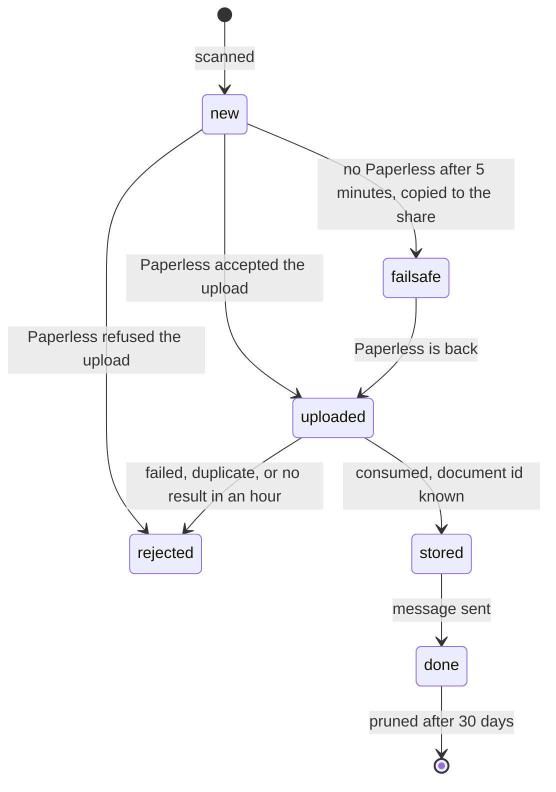

# How it works

## One process owns the scanner

`scanstation.service` runs one Python process. Twice a second it polls the scanner's button with `scanimage -A`, which reports the `--scan` sensor. When the button goes down it scans, processes the pages, and puts the PDF in the spool. Between polls it works the spool, one step per document, polling the button again between steps so a slow Paperless call can delay a press by one step but never swallow it.

The button is never polled during a scan, and a button still held when the scan finishes doesn't start another.

The S1500 drops off USB while its chute is closed and comes back under a new device name when it opens, so the service looks the scanner up again whenever it goes missing. It also goes into power save about 15 minutes after it last woke, where it stays on USB but stops answering. When the station sees that, it sends the scanner a USB reset, which wakes it the same way closing and opening the chute does.

## Scanning

Every scan is raw duplex colour at 300 dpi, with the scanner's own deskew, crop, and blank-page removal turned off, because in testing the driver's deskew rotated one form 37 degrees the wrong way. The scanner keeps paper-length detection and double-feed detection.

SANE reports a double feed the same way as a jam, so both get the same answer: delete any pages already scanned, and send "HOLD this stack: jam or double feed". The ultrasonic thickness check also stops cards and thick envelopes, so for two minutes after a jam the next press scans with the thickness check off.

## The image pipeline

Each sheet's front and back are processed together, in `scanstation/image.py`:

1. Straighten. The skew angle is found once per sheet, from whichever angle makes the lines of text sharpest, and applied to both sides.
2. Crop to the paper. The backing behind the paper is measured and trimmed, along with the shadow at the paper's edge. Anything smaller than 110 x 75 mm is treated as a card and keeps a 3 mm margin, so a coloured stripe on a licence isn't mistaken for a shadow.
3. Correct the colour. A tone curve and white balance fitted against Fujitsu's own ScanSnap Manager output, in a way that can't shift hue. A page with almost no colour is saved greyscale.
4. Drop blank pages. A page with almost no ink goes, after fold creases are cleared, so the back of a folded letter is dropped and a mostly-empty form is kept.
5. Turn it upright. tesseract's orientation detection rotates the page when it's confident, and leaves it alone when it isn't.
6. Flag anything worth a look: a page still skewed, or content touching an edge.

The pages become one PDF, JPEG at quality 90, each page encoded once.

## The spool and the safety rule

Every scan gets a directory under `/var/lib/scanstation/spool` holding the PDF and a JSON state file. Every change of state is written to disk before anything acts on it, so a restart or power cut picks up where it left off. A scan cut off part way by a restart leaves a marker, and the station sends a hold for it on startup.



The whole worker is built around one rule. "Safe to shred" is sent only when Paperless reports the document stored, or when the failsafe share holds a copy. Every other outcome is either a "HOLD this stack" message or silence while it retries.

A few details that follow from that:

- Uploads back off from 15 seconds to two minutes between attempts while Paperless is down.
- If a crash means the same PDF was uploaded twice, Paperless reports a duplicate. The station checks the checksum, and if the existing document is its own upload it carries on as normal.
- Once stored, the station waits up to three minutes for paperless-gpt to title the document, so the message has a real name in it.
- A stored document with less than 15 characters of text per page is flagged as unreadable.
- Each message about a document is sent once. If Pushover is down, it's retried until it goes. Messages from the moment of scanning (a jam, an empty feeder, a scan that couldn't be processed) are sent once and not retried.
- Rejected and failsafe documents are never pruned from the Pi.

## Tests

The tests run on any Linux box with numpy, Pillow, and tesseract:

```bash
python3 -m unittest discover -v
```

They cover the worker's state machine against fake Paperless, failsafe, and notifier objects, the scanner wrapper with fake `scanimage` runs, the spool across restarts, and the image pipeline on synthetic pages.
